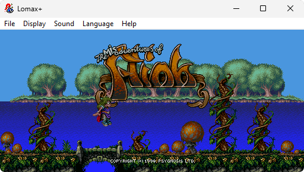

## Lomax+ | Flink

This is a mod for **Lomax** that brings the entirety of **The Misadventures of Flink** to the game. It adapts all the content from the **Sega CD** version of Flink, including levels, enemies/bosses and cutscenes, while also modifying certain Lomax mechanics to better fit Flink's design.

For disclosure, this project is AI-assisted: a coding agent wrote most of the code, I just planned the features and reviewed the code implementation; everything has been manually tested and refined.

### Setup

Download and unpack the mod files in the game folder next to `LOMAX.EXE`, the `FLINK.DLL` file full path should be `MODS/FLINK/FLINK.DLL`.

Next, you need a **Redump-verified** copy of the **European Sega CD** version of Flink in `BIN/CUE` format, and place it under `MODS/FLINK`, then execute the extractor program `FLINK.EXE`. It will unpack/convert all the necessary game data. Once it's done, you can delete Flink's disc image.

To enable the mod, start Lomax normally and go to **File > Properties > Extra**, and select **Flink** in the setting **Load Mod**. A restart is required.

### Build
To build the loader files simply run `build.bat`; it'll generate the files `FLINK.DLL` and `FLINK.INI` inside the `build` directory. An additional flag `-extractor` is available, which builds Flink's data extractor program as `FLINK.EXE`. Make sure to have **MSYS2** with **MinGW32** installed, as a 32-bit **GCC** binary is needed.

### Notes
- The library **MinHook** is used to hook all the game functions.
- The `docs` folder has detailed information about the game and mod's code.