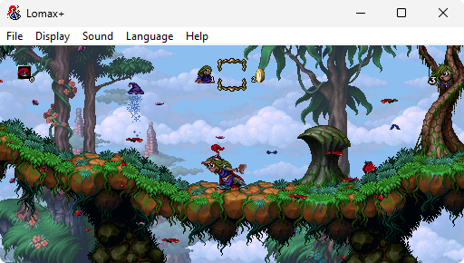

## Lomax+

**Lomax+** is a loader for **Lomax**, a 2D side-scrolling platform game released by **Psygnosis** in 1997. It provides several enhancements and fixes to improve the compatibility with modern versions of Windows.

For disclosure, this project is AI-assisted: a coding agent wrote most of the code, I just planned the features and reviewed the code implementation; everything has been manually tested and refined.

### Features

- **Display enhancements:**
  - Modern Direct3D 11 renderer.
  - Borderless fullscreen with proper image scaling.
  - Widescreen support (up to 512x240).
  - High frame rates and VSync support.
- **Easy game installation**: copy the game files without mounting the disc image.
- **Play music without CD:** extract the audio tracks from the disc image and play from files instead.
- **Improved controller support:** use keyboard and controller simultaneously; better button mapping.
- **Compatibility fixes:**
  - Skip CD requirement.
  - Simulate 16bpp color space: fixes display errors.
  - Direct3D RGB emulation: fixes texture palettes.
  - Fast sprite blitting: substantially improves performance on modern Windows.
  - Fix DirectSound mixer detection on modern Windows.
  - Fix transparency rendering.
  - Game fixes to avoid crashes.
- **Extra features:**
  - Restore the loading screen from the console version.
  - Restore the language select screen from the console version.
  - Restore the 50Hz display mode from the console version.
  - Enable the in-game cheat mode.
  - Mods support.

### Setup

Simply download and unpack the loader files in the game folder next to `LOMAX.EXE`, then run `LOADER.EXE`. If you don't have the game installed yet, place the game's disc image in `BIN/CUE` format in the same folder as `LOADER.EXE`, then run the loader. It will copy the game files and music tracks from the disc and then automatically launch the game once finished.

Settings are in **File > Properties**, the same as in the original game.

### Build
To build the loader files simply run `build.bat`; it'll generate the files `LOADER.EXE` and `LOADER.DLL` inside the `build` directory. Make sure to have **MSYS2** with **MinGW32** installed, as a 32-bit **GCC** binary is needed.

### Notes
- The library **MinHook** is used to hook all the game functions.
- The hooking method could flag the loader as a virus; it's a false positive.
- The `docs` folder has detailed information about the game and loader's code.